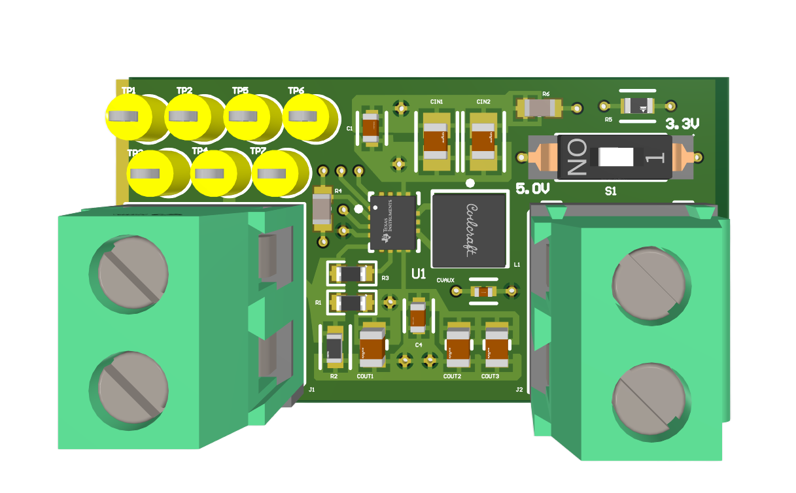

# Adjustable Buck-Boost Converter

A four-layer adjustable buck-boost converter built around the TI TPS63070.

[Portfolio overview](https://felixchen2007.github.io/projects/buck-boost-converter/)

## Project details

- Contribution: Independent project
- Tools: Altium / TPS63070 / Simulink
- Discipline: Power electronics
- Designed input range: 2–16 V
- Nominal output settings: 3.3 V or 9 V

## Documentation

Power electronics, from the feedback network to the physical layout.

### Designing the power stage

I independently designed, manufactured, and assembled a four-layer adjustable buck-boost converter using the TI TPS63070. The design includes feedback, enable, input and output filtering, and voltage selection.

The schematic specifies a 2–16 V input range. The feedback network provides two selectable nominal outputs, approximately 3.307 V and 8.961 V, rounded to 3.3 V and 9 V. These are two preset settings rather than a continuously adjustable 3.3–9 V output.

Regulator reference: [Texas Instruments TPS63070 datasheet](https://www.ti.com/lit/ds/symlink/tps63070.pdf).

### Layout is part of the circuit

I used ground and power planes, kept high-current paths short, and considered thermal behavior throughout the layout. I also imported and checked LCSC and EasyEDA library assets, ran design-rule checks, and added test points.

### Understanding the behavior

I built a simplified Simulink model to explore transient response and control concepts alongside the physical converter design.

### Design focus

- TI TPS63070 converter
- Adjustable voltage selection
- Ground and power planes
- Test points for board bring-up

## Repository contents

This repository currently contains portfolio notes and a project image. Design files, source code, and test results can be added as the documentation develops.
